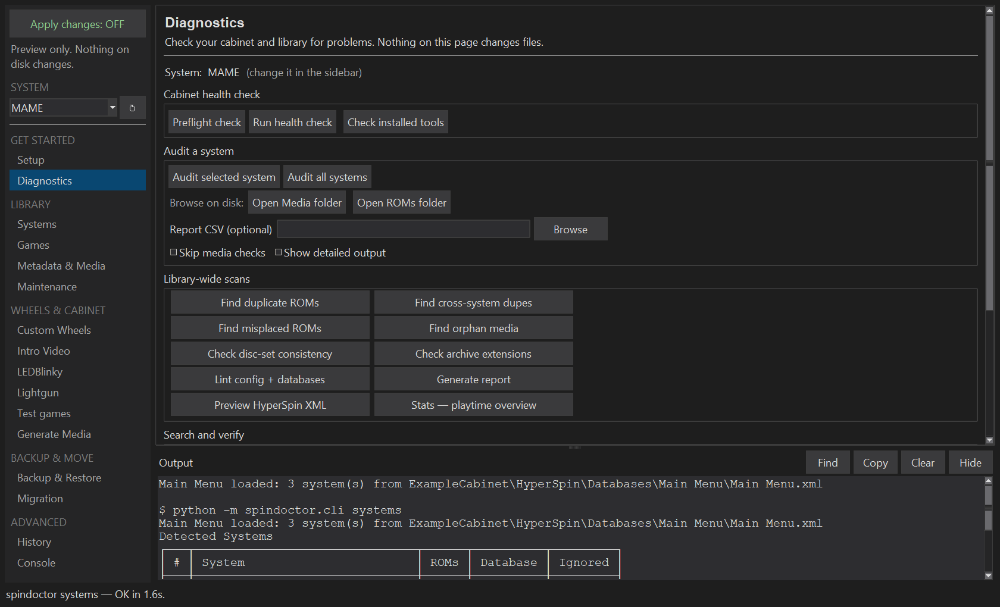

# SpinDoctor

A GUI and CLI librarian for HyperSpin + RocketLauncher cabinets.

- Audit ROMs, databases and media; verify against DATs; find duplicates and misplaced files.
- Fetch metadata and artwork from ScreenScraper, TheGamesDB and Steam; import local media.
- Make missing wheel pictures, videos and screenshots on the PC, without internet.
- Manage systems, PC games, wheel order and first/last/random wheel starts.
- Build Favorites, Recently Played and Most Played wheels.
- Configure LEDBlinky profiles, colors and animations, and Sinden/DemulShooter hooks.
- Launch-test games with screenshots and HTML reports; manage intro videos and cabinet helpers.
- Back up, restore and migrate libraries, with command-specific recovery.

SpinDoctor does **not** install HyperSpin, RocketLauncher or emulators, or download ROMs/BIOS.

## Start here

**Windows, no Python:** download the GUI zip from [Releases](https://github.com/phillram/spindoctor/releases),
extract it and open **`spindoctor.exe`**. Choose `win10` for Windows 10/11 or
`win7` for Windows 7 SP1/8/8.1. The optional CLI zip contains `spindoctor-cli.exe`.
Each EXE works alone. [Binary guide](docs/windows-binaries.md).

**From source, Python 3.8+:**

```text
git clone https://github.com/phillram/spindoctor
cd spindoctor
python -m pip install -e ".[all]"
spindoctor-gui
```

In **Setup**, save your cabinet paths, then run **Diagnostics**.
The sidebar selects a system across pages. **Apply changes** starts off;
review previews before enabling it. Settings and lists can save immediately,
and Toolkit power/display/hardware actions are live. Not every write has undo.
See the [safety model](docs/commands.md#safety).



## CLI

Examples use the pip command `spindoctor`; binary users use `spindoctor-cli`.

```text
spindoctor config init
spindoctor doctor
spindoctor audit --system MAME
spindoctor wheel-start
spindoctor test --system MAME --count 3
spindoctor --help
```

## Documentation

| Need | Guide |
|---|---|
| Install or configure | [Installation](docs/installation.md), [setup](docs/setup.md), [configuration](docs/configuration.md) |
| Use the GUI | [Page guide and current screenshots](docs/gui.md) |
| Run commands | [Cheatsheet](docs/cli-cheatsheet.md), [complete command index](docs/commands.md) |
| Maintain, back up or move | [Workflows and recovery](docs/workflows.md) |
| Diagnose a problem | [Troubleshooting](docs/troubleshooting.md), [storage](docs/spindoctor-files.md) |
| Find a specialist guide | [Documentation index](docs/index.md) |
| Contribute | [Architecture](docs/architecture.md), [tests](docs/testing.md), [Windows builds](build/README.md) |

See [CHANGELOG.md](CHANGELOG.md) for release history. For
[issues](https://github.com/phillram/spindoctor/issues), include the version,
command and a short error excerpt. [Review logs and screenshots before sharing](docs/privacy.md).
