# GUI guide

Launch **`spindoctor.exe`** from a Windows GUI download, `spindoctor-gui` after
pip installation, or `python -m spindoctor.gui` from a checkout.
The binary embeds its workers; no separate CLI EXE is needed.

## Layout and safety

The sidebar groups **15 pages** and shares a **System** selector. Use its refresh
button after changing paths or adding systems. The bottom Output panel shows
commands, progress and errors; History retains this session's runs.

**Apply changes** starts off on every launch. It adds `--apply` to supported
actions, not a universal write lock: configuration, lists and helper-file
generation can save without it. Console commands use their own arguments.
Read warnings before scheduling or invoking live cabinet actions.
See [command safety](commands.md#safety).

**View** controls verbose output, saved logs, help text, dark mode, Output
visibility and UI scale (0.6–2.0). Logs save to `output_dir` when enabled.
Window size, scale and last page are remembered; a new installation opens Setup.
One GUI instance per user is allowed by default.

## First-run wizard

**Setup → Run first-run wizard**, also available in **Help → First-run setup**,
saves core paths and runs a health check. It does not install cabinet software.

## Pages

Screenshots show the actual current GUI with synthetic data, dark theme and
125% UI scale. They contain no real cabinet inventory or scraper credentials.
Long pages scroll; a screenshot shows only the visible viewport.

### Setup

Save paths and scraper credentials, test credentials, browse/open folders, or
start the wizard. Folder drag-and-drop requires the optional GUI dependency.

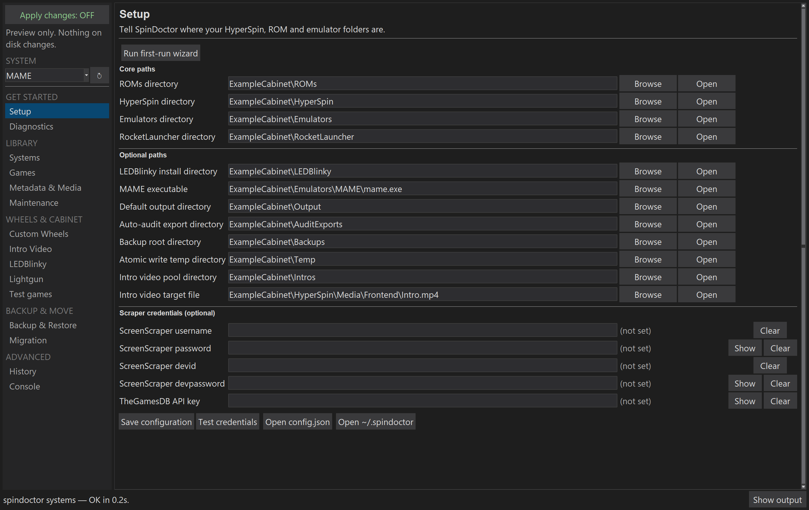

### Diagnostics

Read-only cabinet inspection: preflight (`doctor`, tools inventory, full audit),
system audits, duplicates, misplaced/orphan files, disc/archive checks, search,
DAT verification, coverage and previews. Reports and caches may be created.

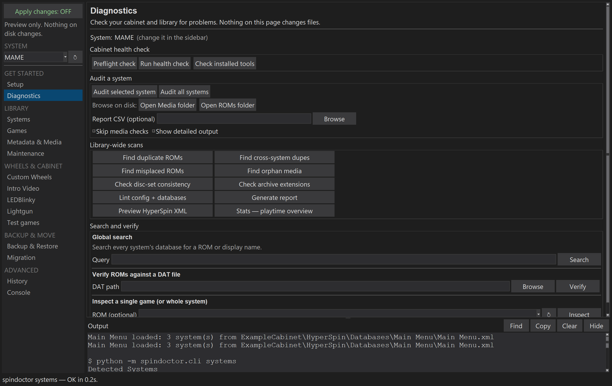

### Systems

Reorder, sort, hide/show, add or remove main-menu systems; bootstrap console/PC
systems and set overrides. **Where wheels start** sets first, last or random
game for selected/all wheels. Close HyperSpin before writing those settings.

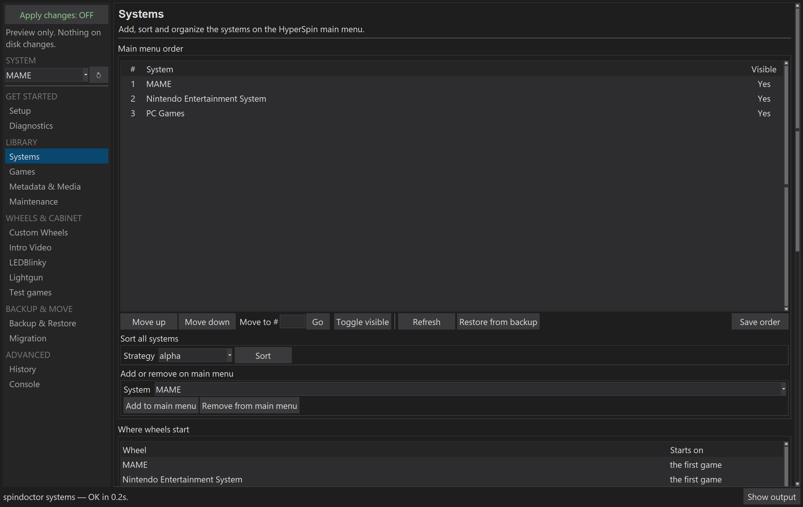

### Games

Reorder/remove database entries, batch-edit metadata, rename/clone games, scan
new PC installations and fix a PCLauncher's executable.

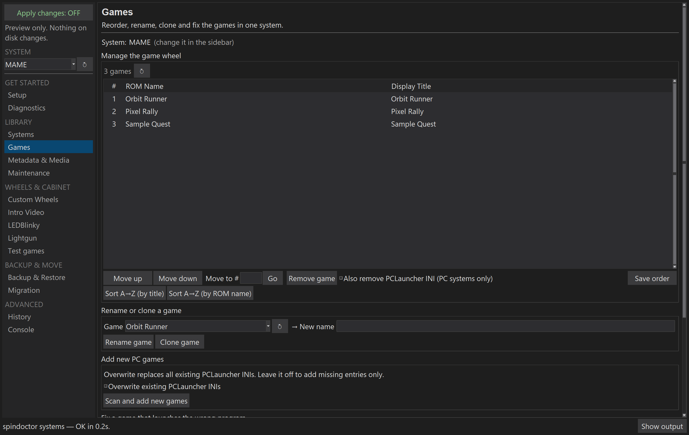

### Metadata & Media

Refresh metadata/artwork for one system, all systems or a saved subset; import
local media, sync databases and generate configs. Per-game overrides pin provider
IDs or Steam App IDs; ambiguous matches can be skipped rather than auto-picked.

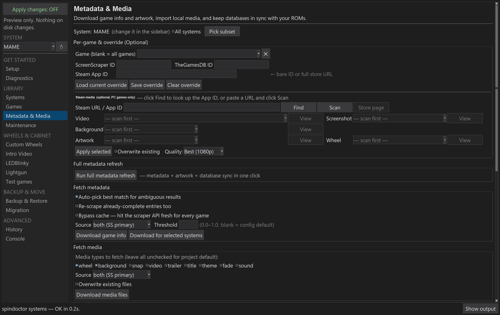

### Maintenance

Preview region/revision curation and veto individual retirements before applying.
Archive supports undo; permanent deletion does not. Also manage ignores and
preview cache/manifest cleanup.

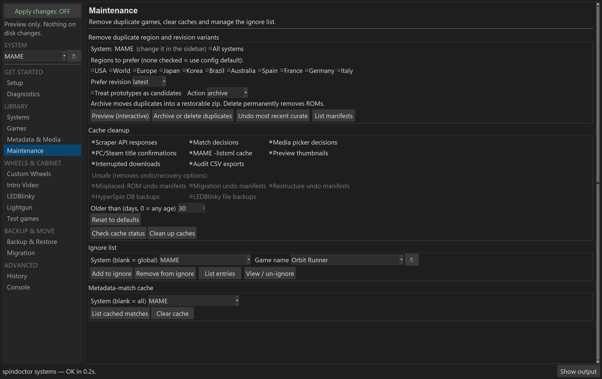

### Custom Wheels

Import/manage favorites, refresh selected smart wheels, register them on the main
menu, install selected Toolkit helpers and schedule startup refreshes.
The Idle Tour settings section controls limits and skipped wheels.

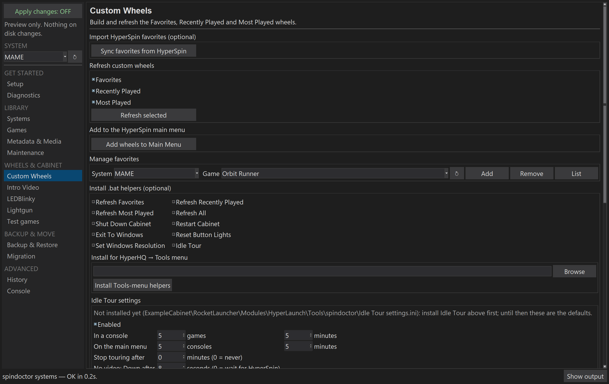

### Intro Video

Manage the enabled pool, add videos, retire/restore selections, swap the current
intro and register/remove its Windows-logon task.

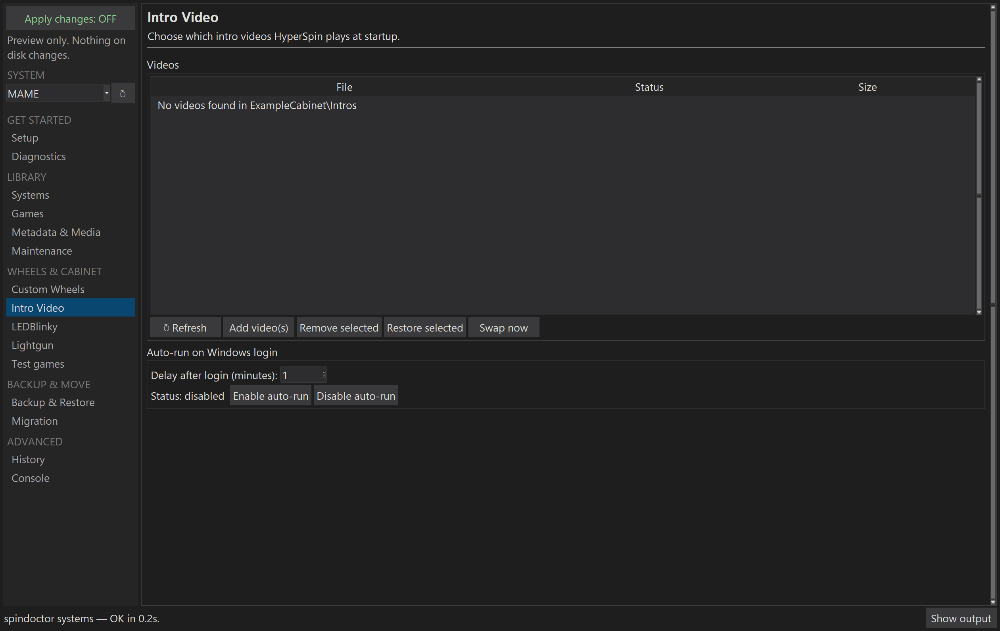

### LEDBlinky

Set up controls, generate/audit/prune profiles, adjust colors and brightness,
and manage lighting behavior. Advanced animation commands are also in Console.
Generated LWAX files need signing in LEDBlinky's Animation Editor.

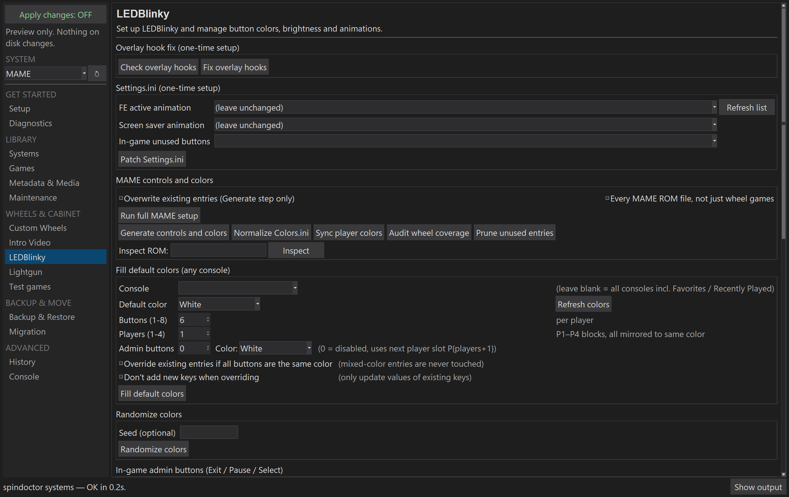

### Lightgun

Detect Sinden/DemulShooter installations, audit hooks and User Functions, and
configure system launch hooks. See [light-gun limitations](lightgun.md).

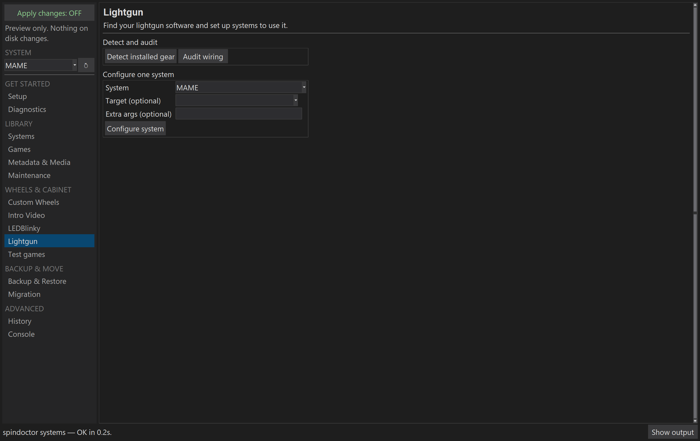

### Test games

Choose system(s), genre, names or a random count; preview with **Show games**.
With Apply on, **Launch games** runs real games through RocketLauncher.
Options include opening HyperSpin first and reporting/removing newly created
files. View failures, screenshots and the HTML report; resume, re-test or recover
an interrupted run. Leave the cabinet alone while tests run.

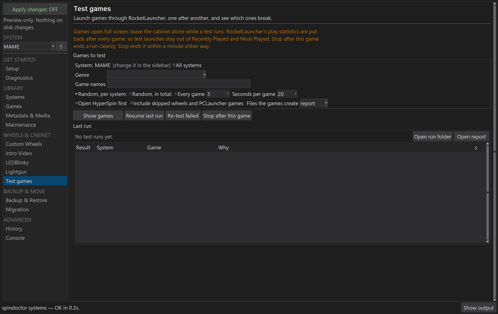

### Backup & Restore

Select components and destination, create/list/inspect snapshots, or preview a
restore. Changed drive letters require the current-paths option and careful review.

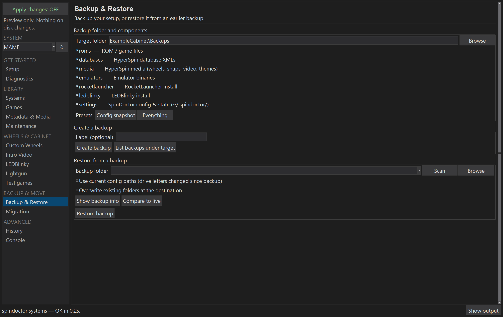

### Migration

Move or copy selected components, optionally verify, update configuration and
inspect/undo prior runs. Emulator-internal paths still need manual checking.

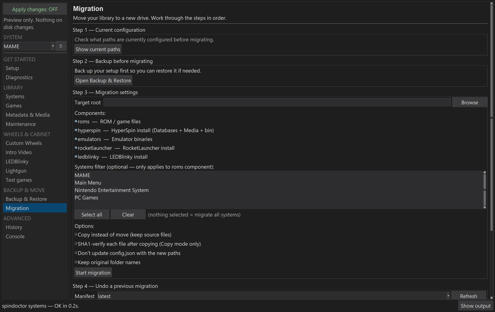

### History

Review session commands, output and exit status. For durable recovery records use
**File → View logs & manifests**, not session History.

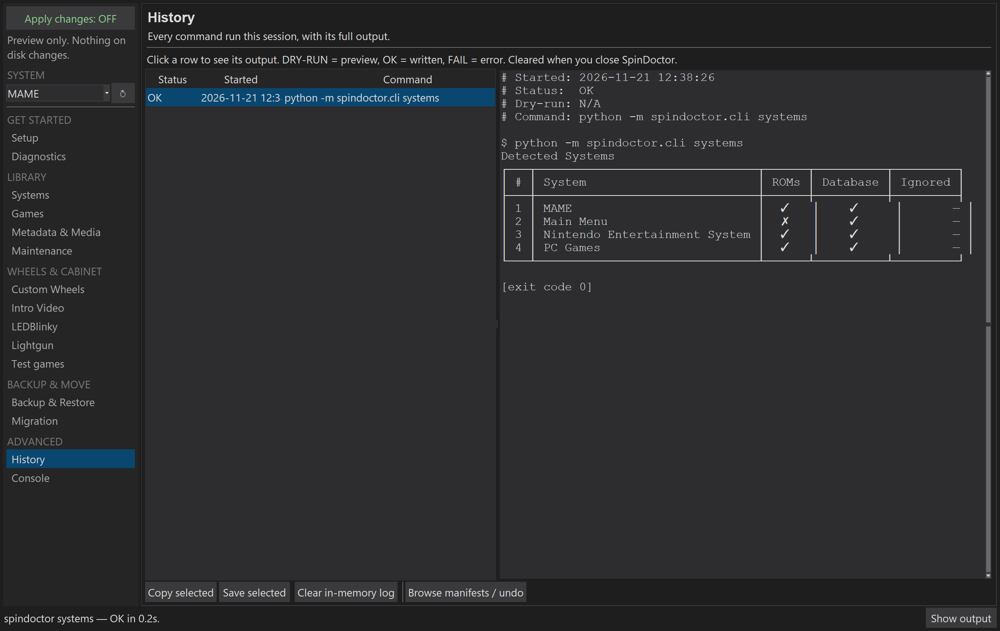

### Console

Choose an editable categorized preset or enter CLI arguments, without the
`spindoctor` prefix. Replace placeholders before running. Explicit flags govern
Console operations; inspect the command before executing.

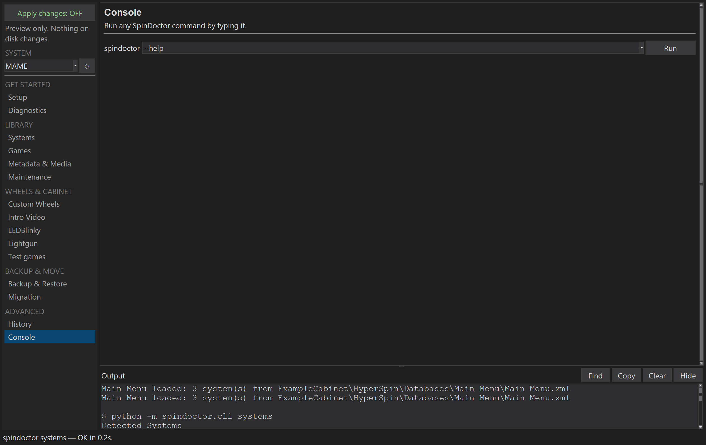

## Menus, shortcuts and stopping

**File** opens configuration/library folders, logs/manifests and theme tools.
**Help** offers setup, release checks and About. The GUI checks GitHub for new
releases; disable with `SPINDOCTOR_NO_UPDATE_CHECK=1`.

- `Ctrl+1`…`Ctrl+9`: first nine pages.
- `Ctrl+F`: find in Output; `Ctrl+backtick`: toggle Output.
- `Ctrl++`, `Ctrl+-`, `Ctrl+0`: adjust/reset UI scale.
- Right-click text fields/output for editing/copy actions.

**Stop** can terminate an ordinary worker before its cleanup completes.
For launch tests it first requests orderly closure and statistics restoration;
**Stop after this game** is gentler. If interrupted, use **Recover now** or
`spindoctor test --recover` before rebuilding ranked wheels.

## Refreshing screenshots

On Windows 10+, from a source checkout with Python 3.10+ and Pillow 11.2.1+:

```text
python scripts/capture_gui_screenshots.py
```

The script isolates HOME/configuration in a temporary synthetic cabinet, disables
update/task probes, runs only a sample `systems` command, and captures the app
window rather than the desktop. Replace all page images together and remove
obsolete filenames when pages change. Never capture a real cabinet for these docs.
